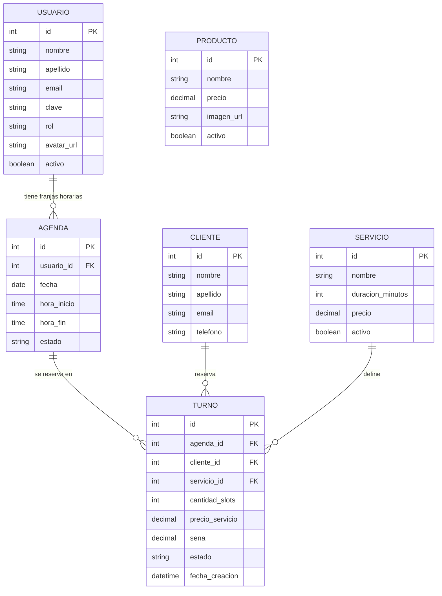

# Figaro Barbershop

Sitio web de reserva de turnos para una barbería. El cliente elige barbero, servicio y horario desde la web pública; el administrador y los barberos gestionan agendas y turnos desde un panel interno.

Trabajo práctico individual — Tecnicatura Universitaria en Desarrollo de Software, ULP.

**Stack:** ASP.NET Core MVC (.NET 10) · ADO.NET (sin ORM) · MySQL (Docker) · Tailwind CSS · Vue 3 · JWT.

## Funcionalidades

**Público (sin login)**
- Landing con servicios y equipo (datos reales de la base).
- Reserva de turno en 4 pasos: barbero → servicio → día y horario → datos de contacto.
- Se pide primero el email: si el cliente ya existe, se completan sus datos y puede editarlos (por ejemplo, el teléfono).
- Seña fija de $5.000 (o el precio del servicio si es menor), informada al confirmar.

**Panel interno (con login)**
- **Agenda:** grilla semanal de franjas de 30 minutos, lunes a sábado de 9:00 a 20:00. Se generan automáticamente y cada barbero puede bloquear franjas o días.
- **Turnos (Vue + API JWT):** listado con filtros y paginado por servidor, alta, y cambio de estado (Finalizado, Cancelado, No se presentó). Al cancelar se liberan las franjas; si no se presenta, se conserva la seña.
- **Servicios y Productos:** ABM con baja lógica. Productos con imagen y filtro de activos/inactivos.
- **Usuarios (solo administrador):** ABM de usuarios, roles y avatar. Cada usuario edita su propio perfil y contraseña.

**Roles**
| Rol | Permisos |
|---|---|
| Administrador | Todo: ve todos los turnos y agendas, elimina entidades, gestiona usuarios. |
| Barbero | Su propia agenda y sus propios turnos, su perfil. No elimina ni gestiona usuarios. |

## Modelo de datos (DER)



Decisiones de diseño:
- **Agenda vs. Turno:** la agenda es la grilla de franjas de cada barbero (`Disponible`, `No disponible`, `Reservado`); el turno es la reserva. Un servicio de 50 minutos ocupa 2 franjas.
- **Snapshots en Turno:** `precio_servicio`, `sena` y `cantidad_slots` se copian al reservar, para que cambios posteriores en el servicio no alteren turnos existentes.
- **Sin doble reserva:** la reserva corre en una transacción con `SELECT ... FOR UPDATE` sobre las franjas.
- **Producto** es una entidad independiente (catálogo); la compra/venta quedó fuera del alcance.

## Cómo ejecutarlo

### 1. Base de datos
1. Levantar MySQL (Docker).
2. Ejecutar `database/FigaroDB.sql`. Crea las tablas (en orden de dependencias) y carga datos de ejemplo.

### 2. Configuración (`appsettings.json`)
```json
{
  "ConnectionStrings": {
    "FigaroConnection": "server=localhost;port=3306;database=figaro;user=<usuario>;password=<clave>"
  },
  "Salt": "figaro-2026-barberia",
  "Jwt": {
    "Key": "<clave de 32 caracteres o más>",
    "Issuer": "FigaroBarbershop",
    "Audience": "FigaroApi",
    "HorasValidez": 8
  }
}
```
> Para un entorno real, `Salt` y `Jwt:Key` deberían ir en variables de entorno o user-secrets, no en el repositorio.

### 3. Estilos (Tailwind)
```bash
npm install
npx @tailwindcss/cli -i <entrada.css> -o ./wwwroot/css/tailwind-output.css --watch
```
Las páginas públicas usan `wwwroot/css/figaro.css` (CSS plano) y no pasan por Tailwind.

### 4. Aplicación
```bash
dotnet run
```
Reiniciar la app al agregar archivos en `wwwroot` o controladores nuevos.

## Usuarios de prueba

| Rol | Email | Contraseña |
|---|---|---|
| Administrador | admin@figaro.com | Admin1234 |
| Barbero | barbero@figaro.com | Barbero1234 |

## API (JWT)

1. `POST /api/auth/login` con `{ "email": "...", "clave": "..." }` devuelve un token.
2. Enviar `Authorization: Bearer <token>` en el resto de las llamadas.

| Método | Ruta | Descripción |
|---|---|---|
| GET | `/api/turnos` | Listado paginado. Filtros: `estado`, `desde`, `hasta`, `idBarbero`, `q`, `pagina`, `tamPagina`. |
| GET | `/api/turnos/{id}` | Detalle. |
| POST | `/api/turnos` | Alta de turno. |
| PUT | `/api/turnos/{id}/estado` | Cambia el estado (`Finalizado`, `Cancelado`, `No se presentó`). |
| GET | `/api/turnos/clientes?q=` | Búsqueda de clientes. |
| GET | `/api/turnos/barberos?q=` | Búsqueda de barberos (solo administrador). |
| GET | `/api/turnos/servicios` | Servicios activos. |
| GET | `/api/turnos/horarios` | Horarios disponibles (`idBarbero`, `fecha`, `idServicio`). |

Un barbero solo ve y modifica sus propios turnos. La colección de Postman está en `postman/Figaro_Barbershop_API.postman_collection.json` (cambiar la variable `baseUrl` al puerto local).

## Dónde se cumple cada requisito de la consigna

| Requisito | Dónde está |
|---|---|
| 4 o más tablas relacionadas, con relación 1-N | `database/FigaroDB.sql` (Usuario, Agenda, Cliente, Servicio, Turno, Producto). DER en este README. |
| Login, `[Authorize]` y roles | `Controllers/UsuariosController.cs`, `Program.cs` (cookie, política `Administrador`), `Views/Usuarios/`. |
| Funcionalidad restringida por rol | Eliminar y gestión de usuarios solo administrador (`[Authorize(Policy = "Administrador")]` en `ServiciosController`, `ProductosController`, `UsuariosController`); un barbero solo ve su agenda y sus turnos (`AgendaController`, `TurnosApiController`). |
| Avatar de usuario | `UsuariosController` (alta y perfil), `wwwroot/uploads/avatares/`. |
| Uso de archivos (aparte del avatar) | Imagen de producto: `ProductosController`, `wwwroot/uploads/productos/`. |
| ABM con Vue.js y ajax | `Views/Turnos/Index.cshtml` y `wwwroot/js/turnos.js` (listado, alta y cambio de estado, todo por ajax). |
| Listados con paginado por servidor | `ObtenerLista(pagina, tamPagina)` en los repositorios; `RepositorioTurno.ObtenerLista`; `GET /api/turnos`. |
| Búsquedas resueltas en el servidor | Filtro `q` y filtros de `/api/turnos`; `RepositorioCliente.Buscar`. |
| Selección de entidades relacionadas por búsqueda ajax | Buscador de cliente y de barbero en el alta de turno (`/api/turnos/clientes`, `/api/turnos/barberos`); lookup por email en `/Reservar`. |
| API con JWT | `Controllers/Api/AuthApiController.cs`, `Controllers/Api/TurnosApiController.cs`, `Models/ServicioJwt.cs`. |
| Colección de Postman | `postman/Figaro_Barbershop_API.postman_collection.json`. |
| Script de base de datos | `database/FigaroDB.sql`. |
| Un usuario por rol | Ver "Usuarios de prueba". |

## Limitaciones conocidas

- **Sin verificación de email en la reserva pública:** si alguien reserva con el email de un cliente existente, se actualizan nombre y apellido de ese cliente (y el teléfono si lo envía). La consulta pública solo expone nombre, apellido y los últimos 4 dígitos del teléfono.
- **La seña no tiene seguimiento de pago:** se informa el monto, pero no hay un registro de si fue abonada. Tampoco hay política de devolución al cancelar.
- **Horario del servidor:** las validaciones de "horario pasado" usan la hora del servidor (`DateTime.Now`).
- **Horario fijo:** lunes a sábado de 9:00 a 20:00, franjas de 30 minutos. Cada barbero bloquea manualmente los días u horas en que no atiende.
- El administrador no puede tener agenda propia (pendiente: marcar a un administrador también como barbero).
- Los datos de ubicación y contacto de la landing son de ejemplo.